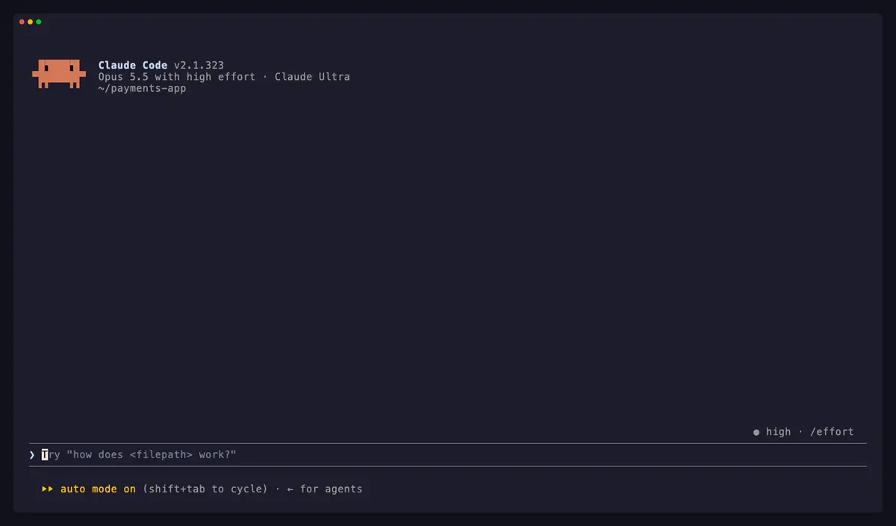

# CLAUDE mod: handoff

**The conversation got long. The work is not done. This mod hands it off in one key.**

Run `/handoff` in Claude Code. Pick the length, the reader and what to include, and Claude writes a handoff message from the conversation: the goal, the state, the next steps, the files, what was tried. Then copy it, clear the context and carry it over, or leave it for the next window.

No more "summarize everything so I can paste it in a new chat", then select, then copy, then open a new window, then paste.

<p align="center">
  
</p>

<p align="center"><sub>A real session, waits cut: <code>/handoff</code> → <code>g</code> writes it → <code>x</code> clears and carries it over → Enter.</sub></p>

## What it does

- **Steps in when the context fills up.** After each turn the mod reads how full the context is. At 50% it shows `ctx 50%` on the status line. At 70% a band appears above the prompt, `● Context 74% · h: Hand off · z: Later`, and the mod writes a handoff in the background, so it is ready when you press `h`. Another is written every 10 points after that.
- **Opens with the goal.** With Goal on, the handoff starts with `/goal <condition>`. On Enter, `/goal` takes the first line as the session's completion condition, and the rest of the handoff goes to Claude with it, as context you never see as a row.
- **Arrives as a card.** In the new session the handoff shows as a card above the prompt: title, the first step, its size and the goal. A handoff sent without a `/goal` line is drawn as the same card in the transcript; ctrl+o shows the whole text.
- **Lets you fix the goal first.** `e` opens a field with the `/goal` condition, so you change it without editing the whole message.
- **Keeps a history per project.** `k` and `j` step through the last 20 handoffs. `d` shows what changed from the one before.

## Install

At the prompt of a Claude Code session in a terminal:

```text
/plugin install handoff --marketplace rolottr/claude-mod-handoff
```

Or from a shell:

```bash
claude plugin install handoff --marketplace rolottr/claude-mod-handoff
```

Answer `y` to add the marketplace, then pick a scope (user scope loads it in every session). The mod is active at once, with no restart.

In the Claude Desktop app, click **+** next to the prompt box, then **Plugins**, **Add marketplace** with `rolottr/claude-mod-handoff`, then **Add plugin**.

The repository is private: you need read access to it on GitHub, and a git credential for github.com on your computer (an SSH key, or `gh auth login` then `gh auth setup-git`).

### Requirements

- Claude Code v2.1.287 or later (`claude --version`). Mods do not run in older versions.
- For the pane on the right side, use the fullscreen layout. Add this to `~/.claude/settings.json`:

  ```json
  { "tui": "fullscreen" }
  ```

  In the default layout, the pane opens above the prompt, at full width.

## Use

Run `/handoff`. The pane opens with the options:

| In the pane | What it does |
| --- | --- |
| `g` Write handoff | Writes the handoff from this conversation. |
| `l` Length | Cycles the cap: 1,000 → 3,000 (default) → no cap. For any other cap, run `/handoff 2500` or `/handoff 2k`. |
| `a` Reader | **Claude** (default): names files, commands and tools as they are. **Any agent**: plain terms, no Claude Code tool names, for a model that may not be Claude. |
| `1`–`7` Include | Goal, State, Next steps, Files & commands, Decisions & dead ends, User preferences, Open questions. All are on by default. With Goal on, the handoff starts with a `/goal <condition>` line, so the next session sets the goal as its completion condition. |

When the handoff is written:

| In the pane | What it does |
| --- | --- |
| `c` Copy | Copies the handoff, for another window, tool or agent. |
| `x` Clear + carry over | Runs `/clear`, then puts the handoff in the prompt box. Edit it or press Enter. |
| `n` Next window | Saves it. The next `claude` you start in this project opens with the handoff in the prompt box. |
| `q` Save + quit | Saves it as `n` does, then ends this session. |
| `g` Write again | Writes a new version. |
| `e` Edit goal | Opens a field with the `/goal` condition. Enter saves it. |
| `k` ‹ Older / `j` Newer › | Steps through this project's handoffs. |
| `d` Diff | Shows what changed from the handoff before. `d` again shows the text. |
| `o` Options | Goes back to the options. |
| ✕ or `Esc` | Closes the pane. |

| Command | What it does |
| --- | --- |
| `/handoff` | Opens the pane: on the options, or on the handoff written in the background. |
| `/handoff 2000` | Sets the cap to 2,000 characters, then opens the pane. `2k` works too. |
| `/handoff nocap` | Removes the cap, then opens the pane. |
| `/handoff last` | Puts the last handoff of this project in the prompt box. |
| `/handoff close` | Closes the pane. |

Above the prompt, once the context is 70% full:

| In the band | What it does |
| --- | --- |
| `h` Hand off | Opens the pane on the handoff written in the background. |
| `z` Later | Hides the band until the context is 10 points fuller. |

Click the band, or press ctrl+x then tab, to give it the keyboard.

## How it works

The mod asks Claude one question over the conversation as Claude last saw it, with no tools, so the conversation is read from the prompt cache and the handoff costs one short answer. The question tells Claude who reads the handoff, which parts to write, to give exact paths and commands, to say what is verified and what is assumed, to leave out secrets, and to end with the first action to take. If the answer is over the cap, the mod asks once for a shorter version.

A handoff saved for the next window is kept on your computer. It waits up to 3 days, and only a different session in the same project takes it, once. The last 20 handoffs of each project are kept on your computer too.

A prompt that starts with `/goal` is a command, so the whole handoff would become the goal. The mod keeps only the first line as the goal, and adds the rest to the turn `/goal` starts as context.

## Uninstall

```bash
claude plugin uninstall handoff
```

Or run `/plugin`, open the **Installed** tab, and remove **handoff**.

## Development

```bash
claude plugin validate .
claude plugin test .
claude --plugin-dir .
```

## License

[MIT](LICENSE)
